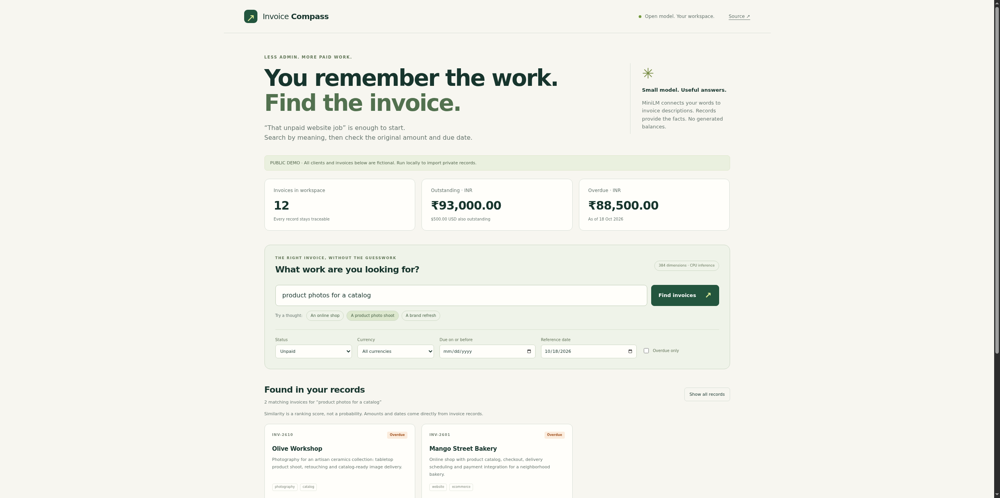

# Invoice Compass

Find the invoice behind “that unpaid website job.” Invoice Compass uses an open embedding model to match a freelancer’s description of the work to the original invoice. Amounts, currencies, dates and payment states stay attached to the source record.

Built from a new repository on October 18, 2026 for the Hacktoberfest Week 2 **Side Hustle** challenge. All included clients and invoices are fictional.

## What it does

- Semantic invoice search with `sentence-transformers/all-MiniLM-L6-v2`, running on the app’s CPU through FastEmbed/ONNX Runtime.
- Exact payment-status, currency, due-date and overdue filters.
- Decimal arithmetic for outstanding and overdue totals, kept separate for each currency.
- Local CSV import with validation, duplicate rejection, a 100-row/1 MB import limit and atomic persistence.
- Source cards with the original description, amount, due date and cosine similarity.
- A deterministic follow-up draft that you review and copy. The app does not send messages.
- A read-only public demo and an import-enabled local mode.



## Run it on your computer

Requires Python 3.12.

```sh
python3 -m venv .venv
.venv/bin/pip install -r requirements.txt
.venv/bin/python -m invoice_compass.warm_model
.venv/bin/uvicorn invoice_compass.web:app --host 127.0.0.1 --port 8000
```

Open `http://127.0.0.1:8000`. The first model download requires internet. After it is cached, model inference and invoice retrieval run without an external model API.

For the shared fictional-data demo:

```sh
INVOICE_COMPASS_DEMO=1 .venv/bin/uvicorn invoice_compass.web:app --host 127.0.0.1 --port 8000
```

`render.yaml` configures the read-only demo on Render’s free service. It downloads and checks the model during the build, then runs one server worker. Free services may sleep when idle.

## Import format

Download the template from the app or use `sample_import.csv`.

```csv
id,client,description,amount,currency,due_date,status,tags
MY-001,Example client,Website redesign and booking calendar,12000.00,INR,2026-11-05,unpaid,website;booking
```

- Currencies: `INR`, `USD`, `EUR`, `GBP`. No exchange-rate conversion is performed.
- Status: `unpaid`, `paid`, or `draft`.
- Dates use `YYYY-MM-DD`. An invoice is overdue only when it is unpaid and its due date is before the selected reference date.
- IDs must be unique. An invalid or duplicate batch is rejected in full.
- Optional tags use semicolons. Up to 1,000 invoices fit in a workspace.

Local imports are saved to `.data/invoices.json` with owner-only file permissions. This is plain JSON, not encrypted storage. The app has no account or multi-tenant access system: run local mode on loopback, on a computer you control. The public demo rejects import requests on the server.

## Verification

```sh
.venv/bin/pip install -r requirements-dev.txt
.venv/bin/pytest -q
.venv/bin/python benchmark.py
```

The initial run passed **10 tests**, including real model retrieval, CSV persistence, atomic duplicate rejection, invalid monetary values, currency separation and public-demo import protection.

Browser checks exercised semantic search, the USD filter, an empty result, CSV import and duplicate rejection through the real API/model. The 390 px mobile layout has no horizontal overflow. See `docs/verification.json` and [the mobile screenshot](docs/mobile.png).

`benchmark-results.json` records a fixed smoke test of eight paraphrases against 12 fictional invoices. On the development machine:

| Method | Intended invoice ranked first |
| --- | --- |
| MiniLM semantic search | 8/8 |
| Simple keyword-overlap baseline | 4/8 |

For example, “product photos for a catalog” retrieves the ceramics photography invoice, while the keyword baseline puts the bakery’s website first. This is a tiny handwritten evaluation, not a production benchmark or a study with real customer invoices. Re-run the script to measure your own environment.

## Why open inference matters here

Invoice descriptions can contain client details. The model can run on an ordinary CPU without uploading invoice text to a hosted model provider. The model weights and the application can be inspected, replaced and self-hosted. A hosted instance still processes data on that host; the public demo therefore accepts only its bundled fictional records.

The model ranks meaning. It does not decide how much anyone owes. All financial values and dates come from validated records and deterministic code. Similarity is not a probability of correctness. A modest default threshold can suppress weak matches, but a poor match can still appear, and the model can miss relevant work.

MiniLM is an English-focused short-text encoder and truncates long inputs. This first version does not parse receipt photos, read PDFs, convert currencies, infer taxes, or connect to banking systems.

## Side Hustle

The proposed customer is a freelancer or a small studio with enough invoices that client names and spreadsheet filters are no longer an easy way to find the work. A plausible paid offering would be a packaged local installation, onboarding and support. That business idea is unvalidated; there are no claimed paying users or revenue.

## Credits and licenses

- Application code: MIT, Copyright 2026 Jalkarna Gautam.
- [all-MiniLM-L6-v2 model](https://huggingface.co/sentence-transformers/all-MiniLM-L6-v2): Sentence Transformers, Apache 2.0. The model card describes its training, intended uses and limitations.
- [FastEmbed](https://github.com/qdrant/fastembed): open model inference with ONNX Runtime. The ONNX model distribution comes from Qdrant’s model repository.
- FastAPI, NumPy, ONNX Runtime and Uvicorn are dependencies, not code authored for this project.
- Built with assistance from OpenAI Codex. All demo invoice records were written as synthetic test data for this project.
